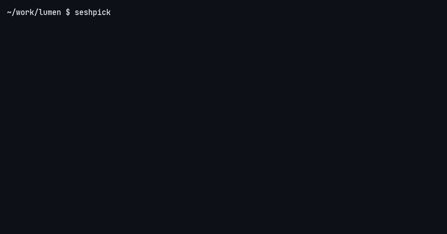

# seshpick

Find any Claude Code session, running or closed, and pick up where you left off.

## Install

    uv tool install git+https://github.com/hugomn/seshpick

Needs Python 3.11 or newer, [fzf](https://github.com/junegunn/fzf) and the `claude` CLI.
No other dependencies. `pipx install git+https://github.com/hugomn/seshpick` works too. Both
install `seshpick` and `cs`, the same command under a short alias.

## Usage

    seshpick                  pick from every session on this machine, newest first
    seshpick triage           same, already narrowed to "triage"
    seshpick --open ID        open a session without the picker (ID may be a prefix)
    seshpick --fork ID        same, as a fork: a new session that starts from the old one
    seshpick --json [query]   the list as JSON, ranked the same way, for scripts and agents

In the picker, **enter** opens the session in its own folder, or jumps to its tab if it is
already running. **ctrl-f** forks it. **esc** quits.

## Why

Claude Code can already resume any session: its picker lists the current project and widens
to every project with a keystroke, a session id resumes from anywhere, and a name you gave with
`/rename` resumes from inside that repository. What it does not give you is one command, from
any folder and any terminal, that searches every session by name, opens the one you pick in a
new tab in the session's own folder, or forks it, or jumps to it when it is already running.
Without that, the easy habit is to never close anything, until there are thirty tabs and no
idea which is which. `seshpick` is that one command.

## Search

Search ranks like a name search, not a scattered fuzzy match. For each word you type, a session
scores by: title equals the word, the word is a whole segment of the title (split on `-`, `_`,
`/` and space), the word is a substring of the title, the word appears in the project or folder.
Ties go to the most recently touched session. Letters spread through a name never match.

## Where it opens

| Terminal | Opener | What happens |
| --- | --- | --- |
| Rex (`REX_SERVER` set) | `rex` | New tab in the Rex session for that project; a running session gets focused |
| tmux (`TMUX` set) | `tmux` | New window; a running session gets selected |
| kitty, WezTerm | `kitty`, `wezterm` | New tab through the terminal's own CLI |
| anything else | `current` | Runs `claude --resume` right here, replacing `seshpick` |

Override with `--opener NAME`, or in the config.

## Config

Optional, at `~/.config/seshpick/config.toml`:

    opener = "auto"                      # auto, current, rex, tmux, kitty, wezterm, command
    command = "open -a Ghostty {cwd}"    # used when opener = "command"; {cwd} {title} {cmd} are shell-quoted

    [projects]                           # folder substring -> project label shown in the list
    "work/acme" = "Acme"                 # with Rex, the label also names the Rex session to use
    "oss/" = "Open source"

    [rex]
    default_session = "Scratch"          # Rex session for folders that match nothing

Without a config, the label is a Rex session name found in the folder path, or the folder name.

## How it works

Running sessions come from `claude agents --json --all`. Closed ones come from
`~/.claude/projects/*/<session-id>.jsonl`: only the first and last 256 KB of each file are read,
for the folder, the first prompt, the `/rename` name and the auto title. Nothing is written
there and nothing beyond a one-line title is ever shown. The picker is fzf with its own matcher
off; `seshpick` ranks and reloads the list on every keystroke. Local only: no network, no daemon, no
database. A temp file holds the list while the picker is open and is deleted when it closes.

## Limits

- The transcript format belongs to Claude Code and is undocumented. `seshpick` reads it defensively,
  but a format change can cost it titles until it is updated.
- Jumping to a running session works in Rex and tmux. Elsewhere `seshpick` says it is running and where.
- A session whose folder was deleted is listed but refused on open, because it would break.
- A session resumed in a folder Claude has never trusted shows Claude's trust prompt first.

## Roadmap

The registry row is agent-neutral (`id`, `agent`, `cwd`, `title`, `updatedAt`, `state`,
`resumeCmd`, `forkCmd`), so an adapter for Codex CLI or OpenCode is a function that returns such
rows and a resume command. Not promised, but the shape is there.

## License

MIT, Hugo Nogueira.
